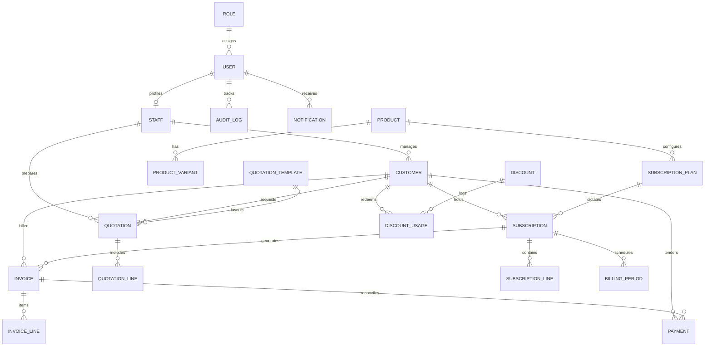

# LOOPNEX — Database Design & Schema Specifications

> **Milestone: COMMIT 01 — Foundation Core**  
> Database Engine: **PostgreSQL**  
> ORM: **Prisma ORM (v6.4+)**

---

## 1. Schema Design Principles

1. **Monetary Precision Rule**:
   All monetary amounts, line-item totals, discounts, taxes, and customer ledger balances use `Decimal @db.Decimal(12, 2)` (or `@db.Decimal(6, 4)` for tax and percentage rates). Storing currency as `Float` or `Double` is strictly forbidden to prevent IEEE 754 precision drift.
2. **Deterministic Primary Keys**:
   All core models use Collision-resistant Unique Identifiers (`cuid()`) for primary keys, preventing sequential enumeration attacks while ensuring index clustering efficiency.
3. **Audit Immutability**:
   `createdAt` and `updatedAt` timestamps exist on all mutable entities. The `AuditLog` table maintains an append-only timeline of critical financial actions.

---

## 2. Planned Domain Entity Map (21 Models)



---

## 3. Entity Specification Table

| # | Entity Name | Table Name | Category | Primary Purpose | Monetary Fields |
|---|---|---|---|---|---|
| 1 | **User** | `users` | Identity | Platform user authentication and profile metadata | None |
| 2 | **Role** | `roles` | Security | Role-based authorization and granular permissions JSON | None |
| 3 | **Staff** | `staff` | Identity | Internal sales, finance, and account managers | None |
| 4 | **Customer** | `customers` | Core Operations | Corporate subscriber accounts, tax IDs, credit balances | Balances |
| 5 | **Product** | `products` | Catalog | Master service definitions and SKU groupings | None |
| 6 | **ProductVariant** | `product_variants` | Catalog | Specific add-ons, storage tiers, or license seats | `price (12, 2)` |
| 7 | **SubscriptionPlan** | `subscription_plans` | Catalog | Recurring cadences (Monthly, Annual), trial policies | `price (12, 2)` |
| 8 | **QuotationTemplate** | `quotation_templates` | CPQ Engine | Pre-configured legal terms and quotation layouts | None |
| 9 | **Quotation** | `quotations` | CPQ Engine | B2B proposal contracts with approval statuses | `subtotal, total (12, 2)` |
| 10 | **QuotationLine** | `quotation_lines` | CPQ Engine | Line items, quantities, and negotiated unit rates | `unitPrice, total (12, 2)` |
| 11 | **Subscription** | `subscriptions` | Core Engine | Active recurring contracts and billing lifecycles | None |
| 12 | **SubscriptionLine** | `subscription_lines` | Core Engine | Specific recurring plan and add-on components | `unitPrice, total (12, 2)` |
| 13 | **BillingPeriod** | `billing_periods` | Core Engine | Explicit start/end boundaries for recurring cycles | None |
| 14 | **Invoice** | `invoices` | Billing Engine | Accounts receivable invoices, due dates, statuses | `subtotal, tax, total, paid, balance (12, 2)` |
| 15 | **InvoiceLine** | `invoice_lines` | Billing Engine | Itemized billing entries for auditing and taxes | `unitPrice, amount (12, 2)` |
| 16 | **Payment** | `payments` | Payments | Multi-gateway transactions, card/ACH settlement | `amount (12, 2)` |
| 17 | **Tax** | `taxes` | Billing Engine | Jurisdictional tax rates (VAT, GST, State Sales) | `rate (6, 4)` |
| 18 | **Discount** | `discounts` | Promotion | Coupon codes, percentage/fixed volume incentives | `value (12, 2)` |
| 19 | **DiscountUsage** | `discount_usages` | Promotion | Historical redemption logs per account | None |
| 20 | **Notification** | `notifications` | System | In-app alerts for renewals, invoices, and risks | None |
| 21 | **AuditLog** | `audit_logs` | Security | Immutable ledger of financial and administrative changes | None |

---

## 4. Migration & Schema Verification

Prisma is configured with PostgreSQL as its target provider.

To generate the local type client:
```bash
npm run prisma:generate --workspace=server
```

To apply migrations against your PostgreSQL instance:
```bash
npm run prisma:migrate --workspace=server
```
